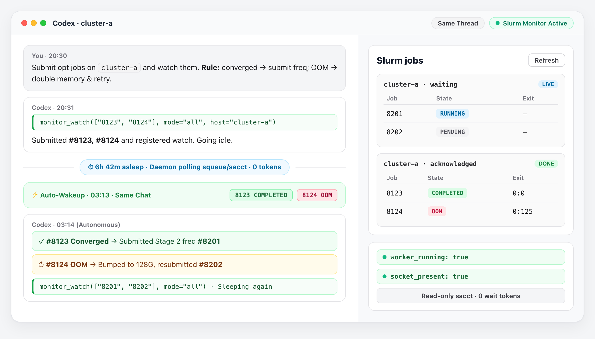
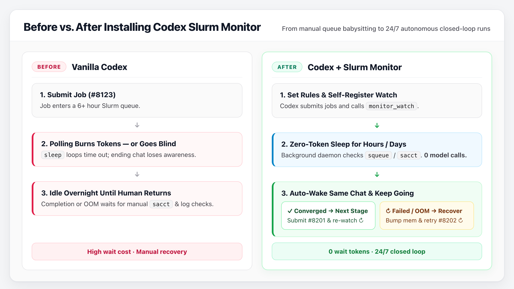
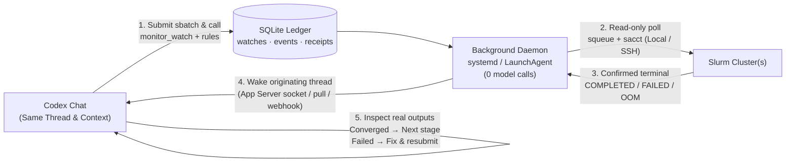

<div align="center">

# Codex Slurm Monitor

**English** · [简体中文](README.zh-CN.md)

**Turn Codex into an autonomous, long-running HPC research agent.**

Let Codex configure its own Slurm queue watches, sleep at **zero token cost** while jobs run for hours or days, and **wake itself up in the exact same chat** when jobs finish or fail — to verify outputs, advance to the next stage, or recover automatically using your pre-set rules.

[](#option-2-manual-installation)
[](#quick-start)
[](#configuration)
[](LICENSE)

</div>

---



> *One persistent Codex thread: submit jobs → self-register queue watches (`monitor_watch`) → sleep for hours with **0 model calls** → wake automatically on confirmed `sacct` terminal states → verify real outputs, submit Stage 2, or auto-recover OOM/failures → repeat.*

---

## Why Codex Slurm Monitor?

Standard coding agents break down on HPC clusters because scientific jobs run for hours or days. You either trap the agent in a polling loop (burning tokens until it times out) or end the chat and babysit the queue yourself.

**Codex Slurm Monitor gives Codex internal queue awareness and self-scheduled wakeups:**

- **Self-configured queue monitoring** — Codex installs and uses its bundled Skill + MCP tools (`monitor_watch`) to register its own watches for single jobs, `all`/`any` job groups, array tasks, or remote clusters over SSH.
- **Zero-token sleep for hours or days** — A tiny OS background daemon (`systemd` on Linux / `LaunchAgent` on macOS) polls `squeue` and confirms terminal states via `sacct` in SQLite. **No model calls are made while waiting.**
- **Rule-driven wakeup in the exact same chat** — Pre-define your rules once (per watch or in `config.toml`). When jobs finish, the daemon wakes the originating `CODEX_THREAD_ID` with full research context intact so Codex can inspect outputs, launch the next calculation, and register the next watch.
- **Automatic failure recovery with strict safety boundaries** — On `FAILED`, `OUT_OF_MEMORY`, or `TIMEOUT`, Codex wakes up to diagnose logs, adjust resources, and resubmit. Meanwhile, the daemon stays **strictly read-only** on Slurm, never assumes a job missing from `squeue` succeeded, never conflates Slurm `COMPLETED` with scientific convergence, and never blindly retries `uncertain` deliveries.

---

## Before vs. After Installing



| Capability | Before (Vanilla Codex) | After (Codex + Slurm Monitor) |
| --- | --- | --- |
| **Long-running jobs (hours / days)** | Chat stops immediately or hits turn timeouts while polling | Codex registers a watch and sleeps indefinitely across restarts |
| **Token cost while waiting** | High if looping `sleep` + `squeue`; blind if idle | **0 model calls** while waiting — background daemon handles polling |
| **Multi-stage workflows** | Human manually checks cluster and prompts every stage | **Closed loop**: wake → verify outputs → submit next stage → re-watch |
| **Overnight failure recovery** | OOM / timeout / crash sits idle until morning | Wakes automatically to inspect logs, fix parameters, and resubmit |
| **Multi-cluster & live view** | Manual `ssh` + `squeue` across terminals | Watch local + SSH clusters from one chat with a built-in MCP panel |
| **Delivery & state safety** | Ad-hoc scripts risk duplicate prompts or false completions | `sacct`-confirmed terminal states, SQLite ledger, waits when chat is busy |

---

## How the Autonomous Loop Works



**Clean separation of responsibilities:**
- The **background daemon** is strictly read-only on Slurm — it only observes job states, persists events, and delivers wakeup receipts. It never submits or cancels jobs and never claims scientific convergence.
- **Codex itself** — woken in the exact originating chat under that chat's permissions — inspects actual calculation files, applies your rules, submits the next stage or fixes failures, acknowledges the event (`monitor_acknowledge`), and registers the next watch.

---

## Quick Start

### Option 1: Let Codex install and set up monitoring (Recommended)

Paste this prompt into the Codex chat where you want notifications and autonomous follow-ups (replace the sample job IDs and rules with yours, or keep only the first sentence to install):

> Install Slurm Monitor from https://github.com/liyang-tju/codex-slurm-monitor and verify that both the background worker and this chat's notification connection are available. Watch Slurm jobs 8123 and 8124: once both finish, check their output convergence — if converged, prepare and submit the next-stage calculation and keep watching; if either fails or hits OOM, inspect the logs, adjust resources, and resubmit.

> [!NOTE]
> For a private repository, the account running Codex needs read access. If newly installed MCP tools are not yet visible in the current chat, Codex can register the watch immediately via the installed stdio entry point (`~/.local/share/codex-slurm-monitor/bin/python -I -m slurm_monitor.server`) using the chat's `CODEX_THREAD_ID`.

### Option 2: Manual Installation

Run on the **host running the target Codex chat**. Requires **Python 3.11+**, **Codex CLI** with `codex plugin add`, and access to Slurm's `squeue` and `sacct`:

```sh
gh repo clone liyang-tju/codex-slurm-monitor
cd codex-slurm-monitor
python3 install.py
```

The installer creates an isolated Python runtime (`~/.local/share/codex-slurm-monitor`), registers the plugin and bundled Skill, starts the background service (`systemd --user` on Linux / `LaunchAgent` on macOS), and prints health flags:

- `worker_running: true` — background observer daemon is active.
- `socket_present: true` — Codex App Server control socket is ready for auto-wakeup.

Open a new Codex chat to load the plugin tools. To update later, run `git pull && python3 install.py` — existing watches and personal settings are preserved.

---

## Everyday Usage & Rule Templates

| Say to Codex | What happens |
| --- | --- |
| *"Submit this optimization and watch it; when it finishes, check `OUTCAR` convergence and launch the frequency job."* | Submits job, registers watch with your rule, sleeps at 0 tokens, wakes to verify and advance automatically. |
| *"Watch 8123 and 8124; if either fails or OOMs, double memory and resubmit."* | Registers a group watch with recovery instructions; wakes to diagnose and recover automatically. |
| *"Tell me as soon as either 8123 or 8124 finishes."* | Uses `mode: "any"` — wakes once at the first terminal job. |
| *"Change that reminder to: list exit codes and check stderr logs."* | Updates the rule on a waiting watch via `monitor_set_prompt`. |
| *"Which jobs am I waiting for?"* / *"Open the job monitor panel."* | Lists active watches (`monitor_list`) or opens the live side-by-side MCP panel (`open_monitor_panel`). |
| *"Cancel that reminder."* | Stops watching via `monitor_cancel`; your Slurm jobs keep running untouched. |

### Setting Default Wakeup Rules

Per-watch instructions spoken in chat always take precedence. To define a personal default wakeup prompt for new watches, edit `~/.config/codex-slurm-monitor/config.toml`:

```toml
prompt = "Inspect the Slurm state and actual output files, verify convergence before advancing, and report any failures."
```

Setting `prompt = ""` sends only the structured event payload. Each watch snapshots its rule at registration time. To customize how Codex registers and handles watches, edit [SKILL.md](plugins/slurm-monitor/skills/slurm-monitor/SKILL.md) and rerun `python3 install.py`.

---

## Configuration

<details>
<summary><b>Multi-Cluster SSH, App Server Socket & Delivery Modes (Codex / Pull / Signed Webhook)</b></summary>

<br>

Configuration lives at `~/.config/codex-slurm-monitor/config.toml` (template: [config.toml](config.toml)). Restart the worker after changing hosts, polling interval, socket, or webhook settings.

- **Multi-cluster monitoring (`ssh_hosts`)**: Default polls local Slurm every `30` seconds (`poll_seconds = 30`). Add non-interactive SSH host aliases to watch remote clusters from one Codex host:
  ```toml
  ssh_hosts = ["cluster-a", "cluster-b"]
  ```
  Then simply tell Codex: *"Watch job 8123 on cluster-a."*
- **Codex App Server socket (`control_socket`)**: Auto-wakeup connects to `~/.codex/app-server-control/app-server-control.sock` by default and requires `thread/queue/add` and `thread/queue/start`. On hosts using the Codex-managed daemon, start it with `codex app-server daemon start`. If `socket_present` is `false` (for example, stdio-only desktop sessions), set `control_socket` or use `pull` / `webhook` delivery.
- **Delivery modes**:
  - `codex` *(default)*: Wakes the originating chat thread automatically when idle.
  - `pull`: Records terminal events in SQLite for manual lookup (`monitor_list` / `monitor_read`).
  - `webhook`: POSTs JSON to `webhook_url` (optional `webhook_proxy`). Set `webhook_secret` to sign raw request bodies with HMAC-SHA256 (`X-Slurm-Monitor-Signature: sha256=…`). Retries explicit transient HTTP errors; marks lost post-send connections as `uncertain`. Receivers should deduplicate by `event_id`.
- **Multiple chats & job arrays**: Multiple chats can independently watch the same job. Repeating the same `(thread, host, jobs, mode, delivery)` registration is idempotent. For array tasks, pass member IDs like `8123_4` or allocation IDs; pass all member IDs to watch an entire array. Each watch fires once.

</details>

<details>
<summary><b>Service Operations, Offline Nodes, Reliability Guarantees & Uninstall</b></summary>

<br>

#### Service Management
- **Linux (`systemd --user`)**:
  - Status: `systemctl --user status codex-slurm-monitor`
  - Restart: `systemctl --user restart codex-slurm-monitor`
  - Logs: `journalctl --user -u codex-slurm-monitor`
  - To keep running after SSH logout, enable user lingering per your cluster policy.
- **macOS (`LaunchAgent`)**:
  - Restart: `launchctl kickstart -k "gui/$(id -u)/org.codex.slurm-monitor"`
  - Logs: `~/.local/share/codex-slurm-monitor/worker.log`
- **Custom process managers**: Set `manage_service = False` at the top of [install.py](install.py) and supervise the printed worker command yourself.
- **Shared home directories**: If multiple cluster nodes share `$HOME`, run the worker on one designated login host.
- **Offline nodes**: Build a wheelhouse on an online machine matching OS, CPU architecture, and Python version (including package dependencies, `setuptools`, and `wheel`), then run `python3 install.py` with `PIP_NO_INDEX=1` and `PIP_FIND_LINKS=/path/to/wheels`.

#### State & Delivery Guarantees
- Disappearing from `squeue` never triggers completion — the worker waits for a matching `sacct` record before emitting a terminal event (`UNKNOWN` is shown during accounting lag or query errors).
- Events, delivery receipts, and user acknowledgements are stored separately in a per-user SQLite database.
- If the target chat is currently busy, the worker waits cleanly. Across restarts, it reconciles message IDs, queues, and turn history before delivering; if delivery cannot be verified, it records `uncertain` instead of blindly sending duplicates.
- References: [Slurm job states](https://slurm.schedmd.com/job_state_codes.html) · [sacct fields](https://slurm.schedmd.com/sacct.html) · [Native Codex acceptance report](data/acceptance.md)

#### Uninstall
Stop the background service first:
- Linux: `systemctl --user disable --now codex-slurm-monitor`
- macOS: `launchctl bootout "gui/$(id -u)/org.codex.slurm-monitor"`

Then remove the plugin and marketplace:
```sh
codex plugin remove slurm-monitor@slurm-tools
codex plugin marketplace remove slurm-tools
```
Personal config lives in `~/.config/codex-slurm-monitor/`; runtime and SQLite history live in `~/.local/share/codex-slurm-monitor/`.

#### Tests
From the repository root (with dependencies and `pytest` installed):
```sh
python -m pytest -q data/tests
```
Tests run against temporary SQLite databases with isolated scheduler, chat, and webhook fixtures.

</details>
