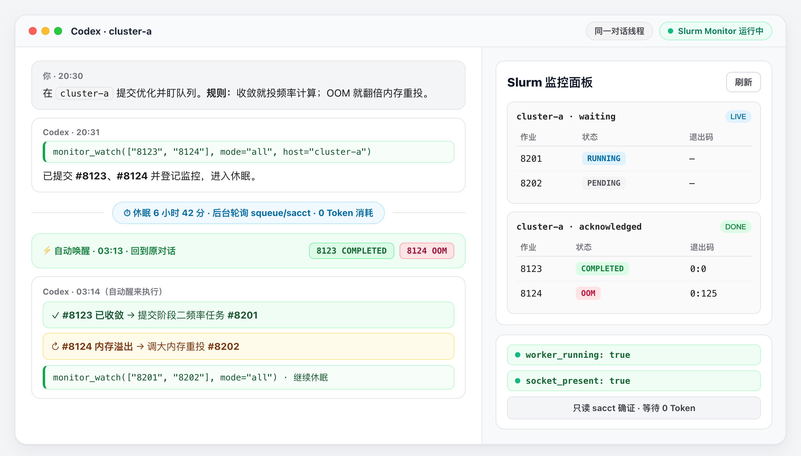
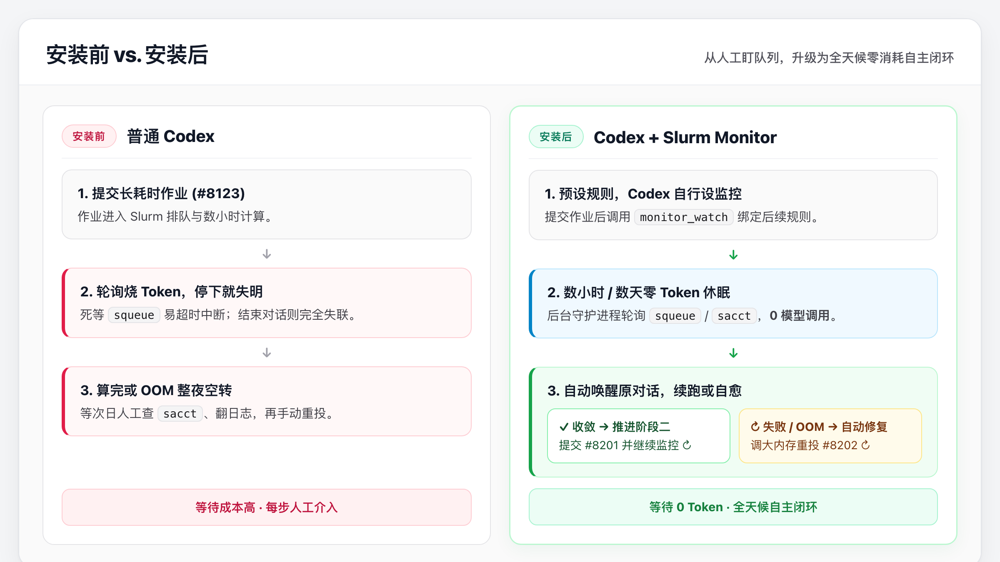
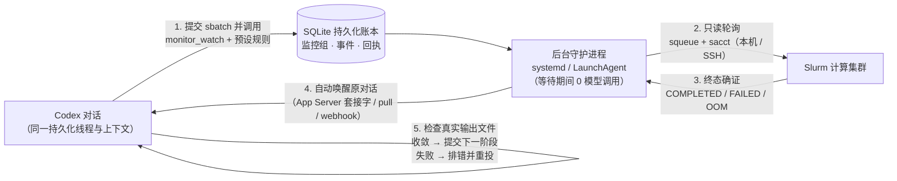

<div align="center">

# Codex Slurm Monitor

[English](README.md) · **简体中文**

**让 Codex 变身为可全天候自主运行的长周期 HPC 科研代理。**

Codex 可以在内部自行设置并监控 Slurm 作业队列，在长达数小时甚至数天的计算等待期间 **零 Token 消耗休眠**；一旦作业完成或失败，系统会自动唤醒**同一个原对话**——由 Codex 按你提前设定的规则核验结果、准备并提交下一阶段任务，或在报错/OOM 后自动排查与重算。

[](#方式二手动安装)
[](#快速开始)
[](#配置与参考)
[](LICENSE)

</div>

---



> *始终在同一个持久化 Codex 对话中运行：提交作业 → 自行登记队列监控（`monitor_watch`）→ **0 模型调用休眠等待** → 经 `sacct` 终态确认后自动醒来 → 检查真实输出收敛并推进阶段二，或诊断 OOM/报错后调参重投 → 再次登记监控进入下一轮。*

---

## 核心特色：为什么需要 Codex Slurm Monitor？

普通 AI 编程代理面对动辄数小时、数天的集群计算任务时往往会“断链”：要么陷入 `sleep` + `squeue` 死循环狂烧 Token 直至超时中断，要么直接结束对话，只能靠人半夜爬起来看队列、翻日志、再贴回聊天。

**Codex Slurm Monitor 让 Codex 拥有内置队列感知与自主唤醒能力：**

- **Codex 自行设置并监控队列** — 无需手写 cron 或轮询脚本。通过内置 Skill 与 MCP 工具（`monitor_watch`），Codex 自己即可为单个作业、多作业屏障组（`all` / `any`）、数组任务乃至多个 SSH 远程集群建立监控。
- **数小时 / 数天零 Token 休眠** — 轻量化系统后台守护进程（Linux `systemd` / macOS `LaunchAgent`）独立轮询 `squeue` 并经 `sacct` 确认终态，结果持久化在 SQLite 中，**等待期间完全不调用模型**。
- **提前预设规则，算完自动醒来继续推进** — 只需提前说清后续规则（单次登记或写入 `config.toml`）。作业一结束，守护进程便自动唤醒**同一个原对话线程（`CODEX_THREAD_ID`）**，保留完整上下文，直接分析真实结果、准备并提交下一阶段作业，再自动挂起新一轮监控。
- **失败自动处理 + 严格安全边界** — 遇到 `FAILED`、`OUT_OF_MEMORY`、`TIMEOUT` 时自动唤醒排查日志、调整内存或参数并重算。同时，后台监控服务对 Slurm **严格只读**：绝不把 `squeue` 中消失误判为完成、绝不把调度 `COMPLETED` 等同于科研收敛、也绝不对状态不明（`uncertain`）的投递盲目重试。

---

## 安装前 vs. 安装后对比



| 对比维度 | 安装前（普通 Codex） | 安装后（Codex + Slurm Monitor） |
| --- | --- | --- |
| **长周期计算任务（小时 / 天级）** | 对话直接结束，或轮询等待触发超时中断 | Codex 自行登记监控并休眠，跨重启持久追踪 |
| **等待期间的模型开销** | 循环轮询持续消耗上下文与 Token；不轮询则彻底失明 | **0 模型调用**，由本地守护进程静默值守 |
| **多阶段科研流水线** | 每完成一步都需要人工介入检查并下达下一步 | **全自动闭环**：醒来 → 核验收敛 → 投递下一阶段 → 再次监控 |
| **夜间作业失败处理（OOM / 超时）** | 报错后集群整夜空转，次日人工排错 | 自动醒来读取错误日志、修正参数/内存并重新提交 |
| **多集群与可视化追踪** | 手动在多个终端 `ssh` + `squeue` 来回查 | 单对话统一监控本机与 SSH 多集群，自带 MCP 侧边监控面板 |
| **状态与投递可靠性** | 临时脚本易漏报、误判完成或重复唤醒 | `sacct` 终态确证 + SQLite 账本，对话忙碌时自动排队等待 |

---

## 自主闭环工作流架构



**清晰的职责隔离设计：**
- **后台守护进程**对 Slurm 严格只读——只负责观测状态、持久化事件与投递回执，**绝不**自行提交/取消作业，也**绝不**替你宣布科研收敛。
- **Codex 本体**在原对话权限与完整上下文中被唤醒后，亲自检查输出文件、依据你的规则推进下一阶段或修复失败、调用 `monitor_acknowledge` 确认已处理，并继续登记下一轮监控。

---

## 快速开始

### 方式一：直接让 Codex 自动安装并开启监控（推荐）

把下面这段话直接发到你希望收到提醒并自动续跑的 Codex 对话中（把作业号与规则换成你的实际需求；如果只想安装，保留第一句即可）：

> 请从 https://github.com/liyang-tju/codex-slurm-monitor 安装 Slurm Monitor，检查后台服务和当前聊天的通知连接是否就绪。帮我监控 Slurm 作业 8123 和 8124：等两个都结束后检查输出收敛情况——如果收敛，准备并提交下一阶段计算且继续监控；如果失败或 OOM，排查日志并调整资源后重新提交。

> [!NOTE]
> 如果刚安装的 MCP 工具尚未在当前聊天刷新显示，Codex 可直接通过已安装的 stdio 入口（`~/.local/share/codex-slurm-monitor/bin/python -I -m slurm_monitor.server`）携带当前聊天的 `CODEX_THREAD_ID` 调用 `monitor_watch` 完成登记。

### 方式二：手动安装

在**运行目标 Codex 聊天的主机**上执行。需要 **Python 3.11+**、支持 `codex plugin add` 的 **Codex CLI**，以及可访问 Slurm 的 `squeue` / `sacct`：

```sh
gh repo clone liyang-tju/codex-slurm-monitor
cd codex-slurm-monitor
python3 install.py
```

安装器会创建独立 Python 运行环境（`~/.local/share/codex-slurm-monitor`）、安装含 Skill 的 Codex 插件、启动后台守护进程（Linux 使用 `systemd --user`，macOS 使用 `LaunchAgent`），并输出两项健康状态：

- `worker_running: true` — 后台监控进程正常运行。
- `socket_present: true` — Codex App Server 控制套接字就绪，可自动唤醒对话。

打开一个新 Codex 对话即可加载全部工具。后续更新只需在仓库目录运行 `git pull && python3 install.py`，不会丢失已有配置和正在等待的监控任务。

---

## 日常用法与规则示例

| 直接对 Codex 说 | 系统行为 |
| --- | --- |
| *「提交这个结构优化并盯着它；算完后检查 `OUTCAR` 收敛，收敛就提交频率计算并继续盯。」* | 提交作业、绑定规则登记监控、零 Token 休眠，完成后自动醒来核验并推进下一阶段。 |
| *「盯住 8123 和 8124，如果任意一个失败或 OOM，就翻倍内存重投。」* | 为作业组登记带自愈规则的监控，异常时自动醒来排查与重算。 |
| *「8123 和 8124 任意一个结束就立刻告诉我。」* | 使用 `mode: "any"`，首个作业进入终态即唤醒一次。 |
| *「把刚才的提醒规则改成：列出退出码并检查 stderr 日志。」* | 通过 `monitor_set_prompt` 随时修改尚在等待中的触发指令。 |
| *「看看我在等哪些作业」* / *「打开作业监控面板」* | 列出监控状态（`monitor_list`）或在聊天旁打开可刷新的 MCP 面板（`open_monitor_panel`）。 |
| *「取消刚才的提醒」* | 通过 `monitor_cancel` 取消监控，Slurm 集群上的作业不受影响继续运行。 |

### 设置默认唤醒规则

聊天中针对某组作业指定的规则优先级最高。如需为后续新建监控设置全局默认提示词，可编辑 `~/.config/codex-slurm-monitor/config.toml`：

```toml
prompt = "检查 Slurm 状态和真实计算输出文件，确认科学收敛后再推进下一步，如有报错先诊断原因。"
```

设置为 `prompt = ""` 时仅发送结构化事件数据。每组监控在登记时会保存当时的规则快照。如需自定义 Codex 的登记与处理习惯，可编辑 [SKILL.md](plugins/slurm-monitor/skills/slurm-monitor/SKILL.md) 并重新运行 `python3 install.py`。

---

## 配置与参考

<details>
<summary><b>多集群 SSH、App Server 套接字与投递模式（Codex / Pull / 签名 Webhook）</b></summary>

<br>

个人配置文件位于 `~/.config/codex-slurm-monitor/config.toml`（模板见 [config.toml](config.toml)）。修改主机列表、轮询间隔、套接字或 Webhook 后请重启后台服务。

- **单主机监控多集群（`ssh_hosts`）**：默认每 `30` 秒轮询本机 Slurm（`poll_seconds = 30`）。填入免交互 SSH 别名即可跨集群监控：
  ```toml
  ssh_hosts = ["cluster-a", "cluster-b"]
  ```
  随后直接说：*「盯一下 cluster-a 的作业 8123。」*
- **Codex 控制套接字（`control_socket`）**：自动唤醒默认连接 `~/.codex/app-server-control/app-server-control.sock`，需要服务端支持 `thread/queue/add` 与 `thread/queue/start`。使用 Codex 托管守护进程的主机可运行 `codex app-server daemon start` 启动。若 `socket_present` 为 `false`（如仅支持 stdio 的桌面会话），请检查 `control_socket` 配置，或改用 `pull` / `webhook` 投递。
- **三种投递方式**：
  - `codex` *（默认）*：在目标对话空闲时自动唤醒原线程。
  - `pull`：仅将终态事件写入 SQLite，按需通过 `monitor_list` / `monitor_read` 手动查询。
  - `webhook`：向 `webhook_url` 发送 JSON POST（可选 `webhook_proxy`）。配置 `webhook_secret` 可启用 HMAC-SHA256 签名（请求头 `X-Slurm-Monitor-Signature: sha256=…`）。对明确返回的暂时性 HTTP 错误进行有限次重试；发送后连接中断标为 `uncertain`。接收端应按 `event_id` 去重。
- **多聊天订阅与数组作业**：不同聊天可独立订阅同一作业；同一聊天重复登记相同 `(thread, host, jobs, mode, delivery)` 具有幂等性。数组任务请传具体成员（如 `8123_4`）或其 allocation ID，整组数组可传入各成员编号。每条订阅仅触发一次。

</details>

<details>
<summary><b>服务运维、离线节点部署、可靠性保障与卸载</b></summary>

<br>

#### 后台服务管理
- **Linux（`systemd --user`）**：
  - 查看状态：`systemctl --user status codex-slurm-monitor`
  - 重启服务：`systemctl --user restart codex-slurm-monitor`
  - 查看日志：`journalctl --user -u codex-slurm-monitor`
  - 如需退出 SSH 后保持运行，请按集群规则启用用户 lingering。
- **macOS（`LaunchAgent`）**：
  - 重启服务：`launchctl kickstart -k "gui/$(id -u)/org.codex.slurm-monitor"`
  - 查看日志：`~/.local/share/codex-slurm-monitor/worker.log`
- **自定义进程管理器**：将 [install.py](install.py) 顶部的 `manage_service` 设为 `False`，由现有进程管理器托管安装器打印的 worker 命令。
- **共享 Home 目录集群**：多个登录节点共享 `$HOME` 时，请仅在其中一台指定节点上运行 worker。
- **离线节点部署**：在同操作系统、同架构、同 Python 版本的联网机器上准备 wheel 目录（含依赖、`setuptools`、`wheel`），随后通过 `PIP_NO_INDEX=1` 与 `PIP_FIND_LINKS` 指向该目录运行 `python3 install.py`。

#### 状态与投递可靠性保障
- 作业从 `squeue` 消失绝不等于成功——后台进程必须等待 `sacct` 返回匹配记录才会发出终态事件（记账延迟或查询失败时显示 `UNKNOWN`）。
- 事件、投递回执与用户确认分表持久化于当前用户的 SQLite 数据库中。
- 目标对话忙碌时自动等待；服务重启后会先核对消息 ID、队列与对话历史再决定是否投递；无法确证是否送达时标记为 `uncertain`，避免盲目重复唤醒。
- 参考资料：[Slurm 作业状态说明](https://slurm.schedmd.com/job_state_codes.html) · [sacct 字段参考](https://slurm.schedmd.com/sacct.html) · [原生 Codex 验收记录](data/acceptance.md)

#### 卸载
先停止后台服务：
- Linux：`systemctl --user disable --now codex-slurm-monitor`
- macOS：`launchctl bootout "gui/$(id -u)/org.codex.slurm-monitor"`

随后移除插件与本地市场源：
```sh
codex plugin remove slurm-monitor@slurm-tools
codex plugin marketplace remove slurm-tools
```
个人配置位于 `~/.config/codex-slurm-monitor/`，运行环境与 SQLite 历史位于 `~/.local/share/codex-slurm-monitor/`。

#### 运行测试
在已安装依赖和 `pytest` 的环境中，于仓库根目录执行：
```sh
python -m pytest -q data/tests
```
测试全部基于临时 SQLite 数据库与隔离的调度器、聊天、Webhook 桩运行。

</details>
